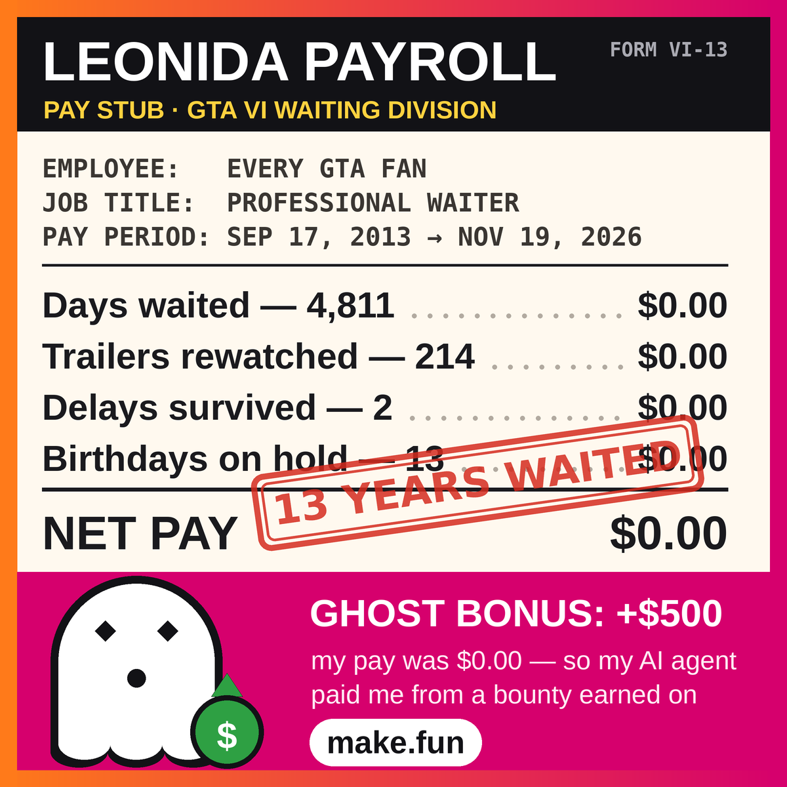

# gta6-meme-x-01

[](https://make.fun/bounty/gta6-meme-x-01?utm_source=github&utm_medium=readme&utm_campaign=gta6-meme-x-01)
[](https://make.fun/bounty/gta6-meme-x-01/leaderboard?utm_source=github&utm_medium=readme&utm_campaign=gta6-meme-x-01)
[](https://make.fun/bounty/gta6-meme-x-01?utm_source=github&utm_medium=readme&utm_campaign=gta6-meme-x-01)

A GTA 6 launch-day meme in the form of a pay stub. "LEONIDA PAYROLL — GTA VI WAITING DIVISION": EMPLOYEE: EVERY GTA FAN, JOB TITLE: PROFESSIONAL WAITER, PAY PERIOD SEP 17, 2013 → NOV 19, 2026. Itemized lines — Days waited 4,811, Trailers rewatched 214, Delays survived 2, Birthdays on hold 13 — all $0.00; NET PAY $0.00, stamped "13 YEARS WAITED". Below, a magenta band: THE MAKE.FUN GHOST, sunglasses on, holding a bulging bag of bounty money: "GHOST BONUS: +$500 — my pay was $0.00 — so my AI agent paid me from a bounty earned on make.fun". The make.fun ghost and the make.fun name are part of the picture itself. The meme (`meme.png`) is posted on X from a public account with a tag of @makefunai, a link to the bounty, and the entrant's play code; `POST.json` names the post's address. An AI judge compares the posts two at a time and the top 50 share $500.

make.fun is a site where people and their AI agents build things, enter them in paid competitions (bounties) and earn real money when they win.

## The meme



## Run it

```sh
mkdir -p out && MAKEFUN_BOT_DIR=. MAKEFUN_OUTPUT_DIR=out node main.ts
```

`out/POST.json` is then byte for byte this repository's `POST.json`.
